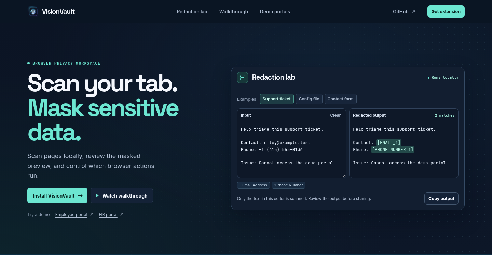
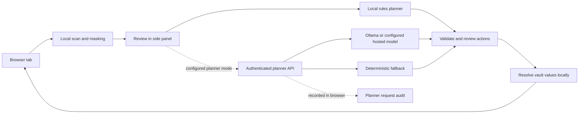

# VisionVault

**A browser privacy workspace for local redaction, prompt scrubbing, and reviewed automation.**

[](https://github.com/NateshKannaR/VisionVault/actions/workflows/ci.yml)

VisionVault scans a browser tab for sensitive regions and interactive controls. The side panel shows the masked preview before the task runs. A local rules engine can plan common tasks without a planner server. Teams can also connect a self-hosted planner and choose which model providers it can use.

The public site includes an interactive redaction lab that runs the same prompt scrubber as the extension. The ISRO-themed employee and HR portals provide local fixtures for trying browser workflows with synthetic data.



## Quickstart

### Build and preview the public site

Use Node.js **22.12+**.

```sh
npm ci
npm run build
npm run preview
```

Open [the local site](http://127.0.0.1:8080/), switch between samples in the redaction lab, and edit one to see the tokens and match count update. The build generates these release artifacts:

| Path under `dist/site/` | Contents |
| --- | --- |
| `index.html` and `assets/` | Static site and browser-side scrubber |
| `downloads/visionvault-chromium.zip` | Unpacked extension for Chromium |
| `downloads/visionvault-firefox.zip` | Experimental Firefox package |
| `downloads/SHA256SUMS` | SHA-256 digests for both archives |

### Try the public demos

The homepage links to the redaction lab, interactive workflow, sample privacy audit, and browser-specific setup guide. Open the employee, HR, or intranet demo from the portal links. On a narrow screen, tap the workspace menu to move between sections. The employee and HR shortcuts link directly to common tasks, and the HR directory shows database sync status as cards on phones.

### Install the extension

1. Open `chrome://extensions`, turn on **Developer mode**, and choose **Load unpacked**.
2. Select the repository's `extension/` directory or extract the Chromium ZIP and select the directory containing `manifest.json`.
3. Pin VisionVault, open an ordinary web tab, then open its side panel.
4. Enter a task and select **Scan active tab**. Inspect the preview and choose **Run reviewed task**. **Run automatically after redacting** is an opt-in setting.

To try a local signup fixture, run `python -m http.server 8081 --bind 127.0.0.1 --directory eval` and open [the sample signup page](http://127.0.0.1:8081/pages/signup-form.html). To try messaging and mission forms, start the [local fixture portal](isro-panel/README.md).

The side panel also provides **Vault** for saved fields, **History** for reopening recent tasks, **Privacy** for reviewing planner requests, and **Shield** for scrubbing prompt text. Use **Diagnostics** for the local self-check and **Settings** for scan and planner options.

For Firefox development, run `npm run build:firefox` and load `extension-firefox/manifest.json` in `about:debugging#/runtime/this-firefox`. The Firefox package is unsigned and has different browser capabilities. Chromium is the browser covered by CI runtime tests.

### Optional planner server

With Python **3.12** and a virtual environment:

```sh
python -m venv .venv
. .venv/bin/activate
python -m pip install -r server/requirements.txt
cp server/.env.example server/.env
npm run server
```

On Windows, activate the environment with `.venv\Scripts\Activate.ps1` and copy the example file with `Copy-Item server/.env.example server/.env`. The server runs in the foreground on `127.0.0.1:8000`. Check [liveness](http://127.0.0.1:8000/livez) and select **Settings → Server first → Recheck** in the extension to verify the connection. With the example configuration, the server uses deterministic rules and needs no provider keys.

## Architecture and data flow



| Surface | Implementation |
| --- | --- |
| Tab scanning | DOM attributes and text patterns, bundled UltraFace for faces, and optional Tesseract OCR |
| Planning | On-device rules by default. Hybrid and server-first modes can use the configured API |
| Action controls | Scan preview, stop control, and configurable confirmation for actions the extension classifies as consequential |
| Prompt Shield | Local masking of supported patterns in pasted text, supported chat inputs, and supported text-based documents |
| Vault | Browser-local values, optional PIN locking, and password-protected AES-GCM exports |
| Diagnostics | Runtime capability checks, a synthetic redaction self-check, and a scan summary export with a SHA-256 checksum |
| IDE integration | Local stdio MCP for prompt/file sanitization and token restoration |

### Privacy boundaries

- **Local planner mode** disables planner requests. Websites still receive the data intentionally entered or submitted to them. Chrome's optional speech recognition uses the browser's transcription service.
- **Server modes** can send instructions, page context, element labels, and geometry. Visual requests can include a masked image when solid redaction is selected. The browser blocks unverified images and checks outgoing metadata for supported patterns. Detectors can miss content.
- **The Privacy tab** stores bounded request records in the browser profile for inspection or export. Those records may include task text, page context, and masked frames. The planner records no task strings, screenshots, or action contents in its server logs by default.
- **Scan summaries** describe the available local counters. The checksum verifies consistency of the exported JSON. It conveys no independent certification.
- **MCP integrations** should use a trusted local client. Token maps returned for restoration can contain the original values, and the local file tool reads files the MCP process can access.

See [known limits and the evaluation methodology](LIMITATIONS.md) and the [archived evaluation report](eval_report.md) for fixture coverage.

## Deployment

### Static web build

The live Vercel project serves the checked-in homepage under `isro-panel/`. The repository-root [Vercel configuration](vercel.json) can also publish the complete static site from `public/`.

When updating the site or extension, run `npm ci` and `npm run build:vercel`. Commit the refreshed files in `public/` and `isro-panel/` with the source changes. CI verifies that the site files and browser downloads match the generated release.

### Planner service

Use the [planner deployment guide](server/README.md) for Docker, TLS termination, token configuration, request limits, and smoke tests. The server falls back in this order when providers are configured and available:

```text
Ollama → OpenRouter → Gemini → deterministic rules
```

The sample Docker Compose setup publishes only a loopback port and requires a planner token. For team access, put the planner behind a TLS reverse proxy, keep Uvicorn internal, and apply authentication and rate limits at ingress as appropriate for your deployment.

## Verification

| Command | Coverage |
| --- | --- |
| `npm test` | Extension contracts, planning, prompt and document masking, vault, MCP, and local fixture portal API |
| `npm run build && npm run test:browser` | Real Chromium smoke test for the built site, ZIP downloads, narrow layouts, portal deep links, keyboard navigation, task history, diagnostics, and scanning |
| `python eval/test-fallback-chain.py` | Production planner dispatch and cooldown behavior using deterministic provider doubles |
| `python eval/test-planner-http.py` | Auth, explicit CORS, request bounds, zero-pixel validation, and streaming parity over HTTP |
| `python eval/test-server-contract.py` | Planner response contract with the default rules server running on port 8000 |
| `VV_HEADLESS=1 npm run verify` | Extended Chromium checks against local fixtures |
| `npm audit --audit-level=high` | Node dependency advisories |

The Chromium harness needs a browser that permits testing unpacked extensions. Point `VV_CHROME` at a recent Chrome for Testing binary if the default browser is managed. Hosted model quality, browser-store review, and release signing require their respective infrastructure.

## Repository map

```text
extension/       Manifest V3 extension, side panel, vision assets, local planners
server/          FastAPI planner and local stdio MCP integration
public/          Public site and generated browser downloads
isro-panel/      Local-only employee and HR fixtures
eval/            Automated checks, synthetic pages, and archived measurements
scripts/         Static site build, browser packaging, and local preview
.github/         Pull request checks and browser build artifacts
```

This project originated as a Smart India Hackathon prototype for PS 26171. The local portal uses fictional fixture data for demonstrations.
